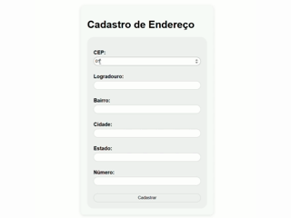

# ViaCEP API


**Encontre endereços brasileiros com rapidez usando um CEP.**

[Sobre](#sobre) · [Tecnologias](#tecnologias) · [Como usar](#como-usar) · [Funcionalidades](#funcionalidades) · [Exemplo de uso](#exemplo-de-uso) · [Estrutura do projeto](#estrutura-do-projeto) · [Roadmap](#roadmap) · [Como contribuir](#como-contribuir) · [Licença](#licença)

<p align="center">
   
</p>

## Sobre

O **ViaCEP API** é um projeto front-end simples e direto em JavaScript que consome a API pública do [ViaCEP](https://viacep.com.br/) para preencher e exibir endereços brasileiros a partir de um CEP.

Ideal para estudar e praticar:
- Requisições HTTP assíncronas com `fetch` e `async/await`
- Manipulação do DOM
- Validação de dados com Expressões Regulares (Regex)
- Tratamento de erros e estados da interface

## Tecnologias

- **JavaScript (ES6+)** — Lógica da aplicação e manipulação do DOM
- **Fetch API** — Consumo da API REST do ViaCEP
- **HTML5** — Estrutura semântica da página
- **CSS3** — Estilização dos rótulos e espaçamento do formulário, com ajuste responsivo para telas maiores.
- **Bootstrap** — Framework CSS usado para aplicar estilos e componentes prontos da interface.
- **API ViaCEP** — Serviço público e gratuito de consulta de CEPs em JSON

## Como usar

1. Clone o repositório:
   ```bash
   git clone https://github.com/saarrr-alves/ViaCEP_API.git
   cd ViaCEP_API
   ```
2. Acesse a pasta do projeto e abra o arquivo index.html no seu navegador (ou utilize uma extensão como Live Server).

3. Digite um CEP válido (8 dígitos numéricos) e clique fora do campo (blur) para realizar a consulta.

## Funcionalidades

- Consulta completa de endereço: Retorna logradouro, bairro, cidade e estado (UF).
- Validação com Regex: Garante que o CEP contenha exatamente 8 números.
- Tratamento de exceções: Identifica CEPs com formato inválido ou inexistentes na base.
- Feedback visual: Exibe mensagens claras de carregamento e erro para o usuário.

## Exemplo de uso

| Entrada (CEP) | Saída esperada |
|---------------|----------------|
| 01001-000 | Praça da Sé, Sé, São Paulo - SP    |
| 00000-000 | Mensagem de erro informando que o CEP não foi encontrado |
| 123 / abc | Mensagem de validação/erro para CEP inválido |

## Estrutura do projeto

```
ViaCEP_API/
├── index.html
├── style.css
├── script.js
├── README.md
└── preview.gif
```

## Roadmap

- [ ] Adicionar spinner ou animação de carregamento na interface
- [ ] Incluir botão explícito de busca além do evento ao sair do campo
- [ ] Implementar layout responsivo (mobile-first, CSS Grid/Flexbox ou framework)
- [ ] Criar testes automatizados com Jest ou Cypress

## Como contribuir

Contribuições são sempre bem-vindas! Para colaborar:

1. Faça um fork deste repositório.
2. Crie uma branch para a sua melhoria ou correção:
   ```bash
   git checkout -b minha-feature
   ```
3. Faça suas alterações e registre o commit:
   ```bash
   git commit -m "feat: adiciona nova funcionalidade"
   ```
4. Envie para o seu fork (git push origin minha-feature) e abra um Pull Request.

## Licença

Este projeto está sob a licença MIT. Sinta-se à vontade para usar, modificar e compartilhar.